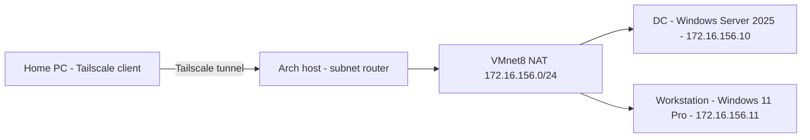

Network Architecture for homelab

Host: Arch Linux, VMware Workstation, VMnet8 NAT network: 172.16.156.0/24, gateway 172.16.156.2

Domain controller: Windows Server 2025 Standard Evaluation, hostname WIN-R6KR17U4JLN, 172.16.156.10, DNS server for lab.ramco.internal, currently holds FSMO roles

Workstation: Windows 11 Pro, 172.16.156.11, DNS 172.16.156.10, domain-joined

Remote access: Tailscale on host Linux, advertising 172.16.156.0/24 as a subnet route, RDP to the VMs over the tailnet

Domain: lab.ramco.internal, NetBIOS RAMCO.

| Machine | Role | IP address |
|---|---|---|
| Arch Host | Subnet router (Tailscale) | *Find IP on host* |
| DC | Domain controller, DNS | 172.16.156.10 |
| Workstation | Domain-joined client | 172.16.156.11 |
